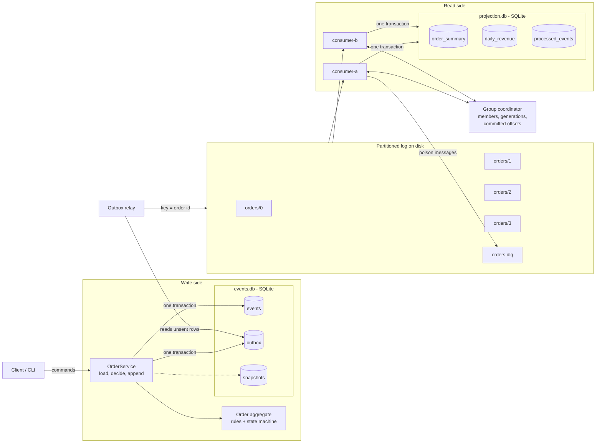

# event-sourced-orders

An order and payment system built on event sourcing, with a small Kafka-like partitioned log underneath. It is built to stay correct when processes crash, messages arrive twice, consumers join and leave, and event formats change over time.

It uses only the Python 3.12 standard library (`sqlite3`, `json`, `zlib`, `pathlib`). The tests use `pytest`.

## The problem

An order service that publishes events to other services fails in a few well-known ways:

- The service saves an order, then crashes before it publishes the event. Other services never hear about the order.
- A consumer updates its read model, then crashes before it commits its offset. On restart it gets the same events again, and revenue is counted twice.
- Two clerks edit the same order at the same moment. The second write silently undoes the first.
- Events for one order go to different partitions. A reader sees "shipped" before "paid".
- One bad message blocks a whole partition, forever.
- The event format changes, and old events on disk no longer match the code.

This project handles each of these cases, shows each one in a demo, and has tests for each one.

## Features

| Area | What it does |
| --- | --- |
| Partitioned log | Append-only topics on disk, split into partitions and segment files. Dense offsets per partition. Time-based retention deletes old segments. A torn write at the end of a file is cut off on restart. |
| Consumer groups | Members join, leave, or time out. Each change starts a new generation and reassigns partitions with a range assignor. Committed offsets are stored on disk. Commits from an old generation are rejected. |
| Event-sourced orders | The `Order` aggregate is rebuilt from its events. Commands are checked against the current state: `created -> paid -> shipped -> refunded`, or `cancelled` before shipping. |
| Optimistic concurrency | Each append states the version it expects. The check runs inside the write transaction. A caller can pass a version (like `If-Match`) to fail fast, or let the service reload and try again. |
| Transactional outbox | Events and their outbox rows are written in one SQLite transaction. A relay copies outbox rows to the log and then marks them as sent. |
| Idempotent consumers | The read model and a `processed_events` table change in the same SQLite transaction. A repeated event is skipped. |
| Projections | `order_summary` and `daily_revenue` read models. Any projection can be rebuilt by replaying the log from offset 0. |
| Snapshots | The aggregate state is saved every N events. A load reads the snapshot plus the events after it. |
| Schema evolution | Each event has a schema version. Upcasters turn old versions into the current shape when they are read. Stored events are never changed. |
| Dead-letter topic | Bad messages go to `orders.dlq` with the error and their source offset. Other errors are retried with exponential backoff first. |

## Architecture



The event store is the source of truth. The log carries events to other readers. The read models can always be thrown away and rebuilt.

### What happens when a consumer crashes

```mermaid
sequenceDiagram
    participant R as Outbox relay
    participant L as Log (orders/1)
    participant A as consumer-a
    participant B as consumer-b
    participant G as Coordinator
    participant P as projection.db

    R->>L: append events (offsets 40..89)
    A->>L: read from committed offset 40
    loop each record
        A->>P: BEGIN; insert processed_events; update read model; COMMIT
    end
    Note over A: crash after offset 76, before commit
    Note over G: no heartbeat from A for 10 s
    G->>G: evict A, generation 3, reassign orders/1 to B
    B->>G: heartbeat fails (old generation)
    B->>G: reload assignment and committed offsets
    B->>L: read from offset 40 again
    loop offsets 40..76
        B->>P: insert processed_events fails, so skip
    end
    loop offsets 77..89
        B->>P: apply, as normal
    end
    B->>G: commit offset 90 (generation 3)
```

Delivery is at least once. The effect on the read model is exactly once, because the duplicate check and the update share one transaction.

## Quickstart

```bash
git clone <this repo> && cd event-sourced-orders
python3.12 -m venv .venv && source .venv/bin/activate
pip install -e '.[dev]'

pytest -q                        # 179 tests, about 7 s
python -m esorders demo          # full demo, about 1.5 s
python -m esorders demo --orders 500 --seed 42 --dir ./data   # keep the files to look at
```

With `--dir`, the data stays on disk: `log/orders/<partition>/*.log` are plain JSON lines, and `events.db` and `projection.db` open in any SQLite client.

## Demo output

This is a real run of `python -m esorders demo` (200 orders, seed 7). The run is seeded, so the counts are the same each time; only the timings change.

```text
== 1. Write side: commands -> events + outbox (one SQLite transaction) ==
  seeded 3 legacy orders written in schema v1 (dollar strings, no items)
  ran 808 commands for 200 orders -> 814 events
  final states: {'cancelled': 26, 'paid': 21, 'refunded': 20, 'shipped': 136}
  rejected: ship an unpaid order -> InvalidTransition: order tmp-227f437f is created; needs paid
  rejected: pay the wrong amount -> InvalidCommand: payment 1 does not match order total 3500
  rejected: refund a cancelled order -> InvalidTransition: order ord-0004 is cancelled; needs paid or shipped

== 2. Optimistic concurrency ==
  clerk 2 saw v1 but clerk 1 wrote first -> ConcurrencyError: tmp-9de03f5a: expected version 1, found 2
  [PASS] second writer with a stale version is rejected

== 3. Outbox relay with a crash between publish and mark ==
  CRASH: relay crashed after publishing 40 rows; those 40 rows stay unmarked
  817 events in the store, 857 records on the log (40 duplicates)
  records per partition (key = order id, crc32 % 4): [215, 219, 211, 212]
  injected 2 poison messages: malformed JSON and an unknown event type

== 4. Consumer group: crash mid-batch, eviction, rebalance, restart ==
  consumer-a owns ['orders/0', 'orders/1'], consumer-b owns ['orders/2', 'orders/3']
  CRASH: consumer-a crashed after 37 records, before commit
  session timeout evicted ['consumer-a']; rebalance to generation 3
  consumer-b now owns ['orders/0', 'orders/1', 'orders/2', 'orders/3']
  consumer-a restarted and rejoined: consumer-a owns ['orders/0', 'orders/1'], consumer-b owns ['orders/2', 'orders/3']
  delivered 896, applied 817, duplicates skipped 77, retries 2, dead-lettered 2
  event 128b2f33 failed twice with 'database is locked', then passed after backoff of 0.01 s and 0.02 s
  [PASS] transient failure retried twice, then applied
  DLQ @0: from orders/0@215 after 1 attempt(s): PermanentError: cannot decode record at orders/0@215: Expecting property na
  DLQ @1: from orders/0@216 after 1 attempt(s): PermanentError: OrderTeleported

== 5. Is the read model correct? ==
  [PASS] live projection equals a fold over the event store (205 orders)
  [PASS] each event applied once (817 processed = 817 events)
  [PASS] 2 poison messages in the dead-letter topic
  legacy v1 orders after upcasting: legacy-001 $46.19 paid, legacy-002 $79.07 paid, legacy-003 $35.11 paid
  daily revenue (USD):
    2026-03-02  gross   $3,114.62  refunds      $0.00  net   $3,114.62  payments 21
    2026-03-03  gross  $12,240.81  refunds  $2,824.38  net   $9,416.43  payments 67
    2026-03-04  gross  $18,105.08  refunds  $4,213.78  net  $13,891.30  payments 72
  same run without the processed-event table: net revenue $30,782.93 vs true $29,443.82 (off by $1,339.11)
  [PASS] naive consumer double counts; idempotent one does not

== 6. Replay: rebuild the projection from offset 0 ==
  replayed 859 records in 53 ms: applied 817, duplicates 40, undecodable 2
  [PASS] rebuilt projection equals the live projection

== 7. Ordering: key partitioning vs random partitioning ==
  key hash:    0 out-of-order deliveries,   0 orders affected,   0 with the wrong final status (of 205)
  random  :  106 out-of-order deliveries,  86 orders affected,  43 with the wrong final status (of 205)
  [PASS] key partitioning keeps every order's events in order

== 8. Snapshots ==
  one order with 2038 events, snapshot at v2001
  load without snapshot: 2038 events read, median 4.40 ms
  load with snapshot:    37 events read, median 0.46 ms (10x faster)
  [PASS] snapshot load gives the same state

All checks passed.
```

What it shows:

1. Commands that break the rules are rejected before anything is written.
2. A second writer with an old version gets a `ConcurrencyError` and changes nothing.
3. The relay crashes after it sends 40 rows but before it marks them. On restart it sends them again, so the log has 40 duplicates.
4. A consumer crashes after 37 records without a commit. The coordinator evicts it after the session timeout, its partitions move to the other consumer, and that consumer reads the 37 records again. When the first consumer restarts, the partitions are split again. One event fails twice with a transient error and then succeeds. The two poison messages go to the dead-letter topic.
5. The live read model matches a fold over the event store exactly: every event applied once, 77 duplicates skipped (40 from the relay and 37 from the crash). The same run without the `processed_events` table overstates net revenue by $1,339.11.
6. A replay from offset 0 into an empty database gives the same read model.
7. With key partitioning, no order's events are out of order. With random partitioning, 43 of 205 orders end with the wrong status.
8. A snapshot cuts one large aggregate load from 2,038 events to 37.

## Tests

`pytest -q` runs 179 tests.

| File | What it covers |
| --- | --- |
| `test_domain.py` | Every state change and every rejected command: amounts, currency, item rules, refund limits, terminal states, version gaps. |
| `test_concurrency.py` | Stale versions are rejected. A conflict without a version reloads, checks the rules again, and retries. 8 threads add 80 items to one order and get versions 1 to 81 with no gaps. |
| `test_crash_recovery.py` | Property test over 60 seeds. Each seed crashes the relay, then runs random consumer crashes, joins, leaves, timeouts, and batch sizes until the group catches up. The read model must equal the fold over the event store, and each event must be applied once. Across the 60 seeds: 143 consumer crashes, 321 joins, 64 leaves, 709 duplicates skipped, 0 wrong results. The same chaos without idempotency overcounts revenue. |
| `test_groups.py` | Range assignment for 1 to 6 members and 1 to 8 partitions. Generations on join, leave, and timeout. Commits from a zombie member or for a partition it does not own are rejected. Clean rebalances cause no redelivery. |
| `test_replay.py` | Replay equals the live projection and the store fold. Replay is repeatable. Revenue uses event time, not processing time. |
| `test_upcasting.py` | v1 to v2 upcasters, exact decimal parsing, refusal of newer schemas, and old events through both the aggregate and the projection. |
| `test_dlq.py` | Poison messages go straight to the DLQ with headers. Transient errors back off at 0.05 s, then 0.1 s. Backoff is capped. The partition keeps moving after a dead letter. |
| `test_log.py` | Offsets, segment roll, reopen, torn-write recovery, retention, and the consumer reset after retention. |
| `test_outbox.py` | One outbox row per event, no outbox row for a failed append, relay crash duplicates, and per-order order on the log. |
| `test_ordering.py` | Key partitioning keeps order over 10 seeds; random partitioning does not. |
| `test_snapshots.py` | A snapshot load equals a full load, a snapshot from an old layout is ignored, and an old snapshot never replaces a new one. |
| `test_cli.py` | The demo runs end to end and every check passes. |

## Code map

| File | Role |
| --- | --- |
| `esorders/log.py` | Segments, partitions, topics, retention, partitioners, producer. |
| `esorders/groups.py` | Group coordinator, range assignor, committed offsets. |
| `esorders/consumer.py` | Poll loop, commit, retries with backoff, dead-letter topic. |
| `esorders/domain.py` | The `Order` aggregate and its rules. |
| `esorders/events.py` | Event envelope, schema versions, upcasters. |
| `esorders/store.py` | SQLite event store, snapshots, outbox. |
| `esorders/service.py` | Command handlers with optimistic concurrency and snapshots. |
| `esorders/outbox.py` | Outbox relay. |
| `esorders/projections.py` | Read models, idempotent apply, replay. |
| `esorders/ordering.py` | Key vs random partitioning experiment. |
| `esorders/cli.py` | The demo. |

## Trade-offs

**Event sourcing vs CRUD.** With CRUD, the order row holds the current state, and the history is gone unless you add an audit table. With event sourcing, the history is the data: you can answer "what did this order look like on Tuesday", add a new read model later and fill it from old events, and audit every money movement. The cost is real. Reads need projections, which lag behind writes. Every event type is a contract that lives forever, so changes need upcasters. Loading a long-lived aggregate gets slow without snapshots. For a simple admin table, CRUD is the better choice. For orders and payments, where the history matters, events earn their cost.

**At-least-once delivery plus idempotency, instead of exactly-once delivery.** Exactly-once delivery across a network needs coordination between the log and every sink. This project accepts duplicates and makes their effect harmless. The duplicate check and the read model update share one local transaction, so they cannot disagree. This also covers duplicates from the outbox relay, which offset tracking alone cannot catch. The price is a `processed_events` table that grows with every event. Real systems prune it by age, or store a per-partition high-water mark instead, which only works when ordering is strict.

**Partition count.** Partitions are the unit of parallel work: a group can have at most one busy consumer per partition. More partitions allow more consumers, but each one adds files, and a rebalance has more to move. The count is also hard to change later: `crc32(key) % n` sends keys to new places when `n` changes, which breaks per-key order during the change. Pick a count for the peak consumer count you expect, not today's load.

**Snapshots.** A snapshot turns a load from "every event" into "the snapshot plus a few events". In the demo it reads 37 events instead of 2,038, about 10 times faster. Snapshots are a cache, not the truth. They are written after the event commit, outside the transaction, and a snapshot from an old state layout is ignored and rebuilt from events. The cost is extra writes and one more format to keep in step with the aggregate. Most orders have fewer than 10 events and never need one, so `snapshot_every` should be set from real event counts.

**Per-key ordering.** Ordering is only promised inside one partition. Keying by order ID keeps one order's events in order and lets different orders run in parallel. The projection also checks that each event is exactly one version after the last, so a gap fails loudly instead of corrupting the read model. The random partitioning experiment shows what that guard protects against.

**Blocking retries.** Retries happen in place, so a slow, failing message delays the rest of its partition. This keeps per-key order. A separate retry topic would keep the partition moving, but later events for the same order could then pass the failed one.

## Limitations

- One process. The coordinator keeps membership in memory, and there is no network protocol, replication, or leader election. Consumers run in turn, not in parallel threads.
- The log has no compaction, no index file (the offset index is rebuilt in memory on open), and no size-based retention.
- Group offsets live in a JSON file. The projection keeps its own `processed_events`, so a lost offset file only causes redelivery, not wrong results.
- `processed_events` is never pruned.
- A crash between a dead-letter write and the offset commit can write the same dead letter twice.
- The relay is a single worker. Two relays running at once could publish one order's events out of order.
- Backoff has no jitter, so tests can check exact delays.
- Money is integer cents with one currency per order. There is no FX, tax, or partial capture.

## Next steps

- Log compaction by key, so a topic can keep the latest event per order without unlimited retention.
- A DLQ redrive command that sends fixed messages back to the main topic.
- Cooperative (incremental) rebalancing, so a join moves only the partitions that must move.
- Prune `processed_events` with a per-partition high-water mark.
- Run consumers in separate processes with a small TCP coordinator.
- Add more upcasters and a snapshot upgrader, to show a multi-step schema migration.

## License

MIT. See [LICENSE](LICENSE).
